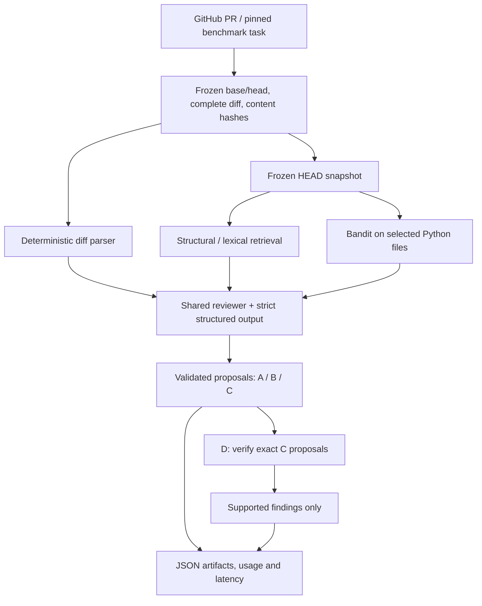

# Context-Aware Code Review

A Python CLI that reviews GitHub pull requests using **repository context, static-analysis evidence, and finding verification**—with a controlled diff-only baseline to measure whether those additions help.

**Research question:** Can an AI code reviewer detect more real defects and produce fewer false positives when it understands the surrounding repository instead of seeing only the PR diff?

A diff shows what changed, but can omit the definitions, imports, and surrounding behavior needed to assess a defect. This project retrieves bounded context from the **frozen PR HEAD snapshot**, rather than sending the entire repository to the model. It focuses on actionable correctness, security, reliability, and performance issues—not style comments.

## Final results

Evaluated on **19 evaluable real-world ReviewBench PRs**, with all four modes completed: **76 task/mode observations**. The table reports **scope-filtered/adapted, pooled micro metrics** from the final `.scoped.json` outputs—not raw upstream ReviewBench metrics.

| Mode | Augmented precision | Augmented recall | Augmented F1 | False positives / PR |
|---|---:|---:|---:|---:|
| **A · Baseline** — diff only | 70.0% | 10.1% | 17.7% | 0.158 |
| **B · Retrieval** — diff + repository context | **100.0%** | **10.3%** | **18.7%** | **0.000** |
| **C · Tools** — B + Bandit evidence | 87.5% | **10.3%** | 18.4% | 0.053 |
| **D · Full** — exact C proposals + verification | 71.4% | 7.4% | 13.3% | 0.105 |

**Repository retrieval was the strongest configuration on the primary micro metrics in this evaluation.** Compared with the diff-only baseline, it improved F1 from 17.7% to 18.7% and reduced observed in-scope false positives from 3 to 0 across 19 PRs. Its 100% precision reflects **7 judge-classified true positives and 0 false positives** in the scoped denominator—not a guarantee of future performance.

Static-analysis evidence did not improve over retrieval alone. Verification reduced recall and F1; its filtering was too aggressive for this experiment. More pipeline stages did not produce a better reviewer. These are small-sample, LLM-judged results, and recall remained low in every mode.

## Controlled ablations

| Mode | Evidence supplied to the reviewer | Final output |
|---|---|---|
| `baseline` | Complete PR diff only | Validated reviewer findings |
| `retrieval` | Diff + retrieved repository context | Validated reviewer findings |
| `tools` | Diff + the same context + Bandit signals | Validated reviewer findings |
| `full` | **Reuses the exact tools proposals** | Only proposals classified `SUPPORTED` |

The final experiment uses the same reviewer model, review prompt, output schema, inference settings, and anchor validation across modes. B/C/D share retrieval preparation; C/D share static-analysis preparation. In combined evaluation, **D does not independently generate another reviewer batch**. A standalone `full` review generates its tools proposals once, then verifies them.

`UNSUPPORTED` and `UNCERTAIN` proposals are removed from D's candidate output, while all decisions remain in provenance. Verification cannot invent findings or change their content or anchors.

## Architecture



- **Frozen inputs:** read-only GitHub acquisition preserves commit identities, complete diffs, and SHA-256 hashes. Safe archive handling rejects traversal and unsafe links; historical tasks never silently fall back to the current branch.
- **Retrieval:** deterministic Python AST/lexical signals combine imports, referenced symbols, definitions, module proximity, and token overlap. Ranked code chunks fit a shared byte budget, exclude diff-represented duplicate lines, and retain paths, ranges, hashes, scores, and selection reasons. AST metadata is cached by content hash. **Semantic embeddings are deferred.**
- **Static evidence:** Bandit analyzes explicitly selected eligible Python files staged from frozen HEAD. Signals are supporting evidence, never automatically final findings. Benchmark tools/full observations fail before a reviewer call if required analysis fails.
- **Review and verification:** OpenAI Responses, versioned prompts, strict JSON-schema output, and local Pydantic validation. Every final finding must reference a repository-relative file and HEAD-side range represented in a changed diff hunk. Supporting context cannot expand valid anchors.
- **Auditability:** save raw model output, parsed findings, prompts/request hashes, settings, retrieval/tool/verifier provenance, token usage, and latency. Generation and benchmark judging are separate.

## Quick start

Requires Python **3.11+**. Pydantic is the only declared Python runtime dependency; Bandit is a separate executable for tools/full modes.

From the repository root:

```bash
python -m venv .venv
source .venv/bin/activate
python -m pip install -e .
python -m pip install 'bandit==1.7.8' pytest

export OPENAI_API_KEY='YOUR_KEY'
export REVIEW_PROVIDER=openai
export REVIEW_MODEL=gpt-6-luna
export VERIFY_PROVIDER=openai
export VERIFY_MODEL=gpt-6-luna
# Optional: export GITHUB_TOKEN for authenticated read-only GitHub access.
```

Use your own credentials; do not commit them. `.env.example` documents variables, but **`.env` is not loaded automatically**. Model access depends on your provider account; model identifiers are configurable.

```bash
python -m reviewer review \
  --repo OWNER/REPO \
  --pr 123 \
  --mode retrieval \
  --request-byte-budget 73728 \
  --context-byte-budget 6000 \
  --max-output-tokens 8192
```

Select `baseline`, `retrieval`, `tools`, or `full`. The CLI displays findings and usage, then saves a run under `results/<run-id>/<mode>.json`. Findings include title, category, severity, file/line range, description, evidence, suggested fix, and confidence. Confidence is a model assertion, **not a calibrated probability**. Empty reviews are valid.

Review commands make read-only GitHub requests and paid model calls. They do not post GitHub comments or modify the target repository.

```bash
python -m reviewer review --help
python -m reviewer evaluate --help
python -m reviewer preflight --help
python -m pytest -q
```

The test suite covers schemas, diff parsing, acquisition/archive safety, evidence isolation, retrieval, Bandit, verification, persistence, continuation, and scoped evaluation using offline fixtures/mocks.

## Evaluation methodology

### Corpus and scope

The final manifest selected Python-labeled ReviewBench tasks with at most 1,000 added + removed lines, excluding the five development tasks. **20 tasks were predeclared; 19 were evaluated.** One Nipoppy task was excluded before model generation because its benchmark file inventory disagreed with its pinned reconstruction and its snapshot contained an unsupported symlink. It was not replaced and is outside every mode's metric denominators. Python is corpus metadata; not every changed file is Python.

Judging uses only goldens in the four defect categories **and** labeled `introduced-by-pr` or `exacerbated-by-pr`. Across the 19 PRs, this retains **149 golden findings: 67 TP and 82 FP labels**; 164 out-of-contract goldens are excluded. Original TP/FP labels are preserved.

The pinned ReviewBench semantic judge performs same-file matching and classifies unmatched candidates. There is no custom line-overlap matcher. Judging uses filtered goldens, so excluded references cannot supply a match. Unmatched classifications outside the declared category/scope contract are excluded and counted separately. Benchmark labels are not inputs to the reviewer or verifier.

### Metrics and controls

Primary precision includes eligible matched and judge-classified novel TPs/FPs. Primary augmented recall is:

```text
(covered eligible golden TPs + eligible novel TPs)
------------------------------------------------
(eligible golden TPs + eligible novel TPs)
```

Primary F1 is the harmonic mean of augmented precision and recall. FP/PR divides in-scope false positives by all 19 completed PRs, including empty reviews. These are **adapted scoped metrics**, not unfiltered native ReviewBench scores. Fixed-golden recall and grounded precision are separate diagnostics; grounded precision excludes unmatched findings. Macro metrics average defined per-PR values and report their denominators; undefined values remain `null`.

| Frozen component | Final setting |
|---|---|
| Reviewer / verifier | OpenAI `gpt-6-luna` |
| Semantic judge, all four modes | OpenAI `gpt-5.4`, selected before scoring |
| Review / verification prompt | v3 / v1 |
| Static analyzer | Bandit 1.7.8 |
| ReviewBench revision | `968291d99e82b3e2969d7e0b4acca62585886c13` |
| Reviewer/verifier output ceiling | 8,192 tokens, including reasoning |
| Request guard | Serialized UTF-8 request bytes + 4,096 margin ≤ 73,728 |
| Shared context / static signal caps | 6,000 / 2,000 serialized-byte estimator units |

The request guard is **not tokenizer-measured tokens**. Complete diffs are never truncated. The common ceiling was frozen before generation from 110% of the measured maximum, rounded upward to the next KiB.

### Reproduction and artifacts

- [Experiment configuration](configs/experiment.toml)
- [Predeclared manifest](configs/reviewbench-final20.json) and [frozen input lock](configs/reviewbench-final20.lock.json)
- [Judge configuration and scoring input hashes](configs/reviewbench-scoring.json)
- [Final evaluation runbook](docs/final-evaluation.md)
- [Scoped metric implementation](reviewer/scoped_evaluation.py)

Generation requires the pinned ReviewBench archive and model credentials:

```bash
python -m reviewer evaluate \
  --benchmark reviewbench \
  --modes baseline,retrieval,tools,full \
  --benchmark-archive .cache/reviewbench/ReviewBench-968291d99e82b3e2969d7e0b4acca62585886c13.tar.gz \
  --subset configs/reviewbench-final20.json \
  --request-byte-budget 73728 \
  --context-byte-budget 6000 \
  --max-output-tokens 8192
```

This is a **new paid generation run**, not a command for inspecting completed results. Follow the runbook for pinned-input preflight, filtered goldens, separate upstream judging, and offline aggregation. ReviewBench has its own Node dependencies and judge credentials; its repository tools may fetch/check out target repositories. The only upstream source patch preserves scope fields in detailed output, without changing matching/scoring semantics.

The results table above comes from:

```text
results/reviewbench-0d6bea40427a4d64bd6f0055875d3d25/
├── summary.json
├── inputs/                  # Frozen review inputs
├── modes/<mode>/runs/       # Raw outputs and provenance
├── modes/<mode>/candidates/ # ReviewBench-compatible findings
├── history/                 # Failed attempts retained across continuation
└── scoring/<mode>.scoped.json
```

Raw results, downloaded repositories, and benchmark artifacts are ignored by Git; the paths above identify the local evaluated run, not bundled dataset downloads. With those artifacts available, inspect the completed comparison offline:

```bash
python scripts/reviewbench_scoring_check.py compare
```

Completed generation observations were preserved across transport-timeout continuations. Historical timeout billing is unknown; token usage and latency are recorded, but this README makes no dollar-cost claim. Old smoke/development artifacts are not final results. Frozen inputs/configuration support repeatable execution, not guaranteed identical model outputs.

## Limitations

- **Small, selected corpus:** 19 evaluable PRs are not a statistically representative sample. No significance or universal performance claim is made.
- **Low coverage:** roughly 7–10% augmented recall across modes means many reference defects remain undetected.
- **Judge uncertainty:** semantic matching/classification is model-based and may vary between modes, including for identical surviving findings. Augmented recall's denominator also depends on novel TPs discovered by each mode.
- **Conservative scope and anchors:** Python-focused retrieval/Bandit, bounded evidence, supported textual diffs, strict snapshot safety, and HEAD anchors can limit which defects are representable.
- **Verification is not ground truth:** its negative result here is part of the ablation, not evidence that verification can never help. No embeddings, additional analyzers, autonomous fixes, or production-service guarantees are claimed.
