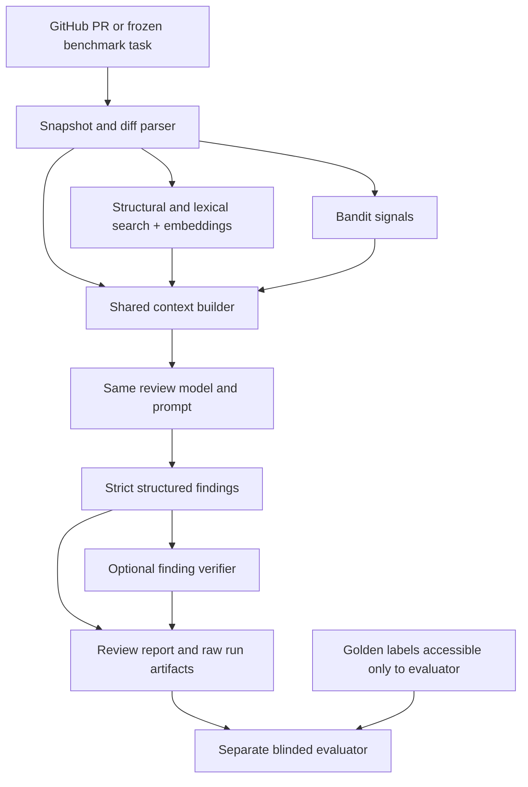

# Repository-Aware AI Code Reviewer

**Status: the diff-only OpenAI baseline, deterministic structural/lexical retrieval,
and Bandit tools mode are implemented with frozen PR inputs, strict output validation,
and offline tests. Mode D finding verification and paired A-D candidate generation
are implemented. Five-task ReviewBench candidate generation is implemented;
the final20 manifest, no-model preflight, and scoped ReviewBench scoring adapter are
implemented. Semantic embeddings remain deferred. The final benchmark generation
and judging have not been run; no benchmark quality results exist.**

Research question: **Can an AI code reviewer catch more real bugs and produce fewer
false positives when it understands the surrounding repository instead of seeing
only the pull request diff?**

V1 targets Python repositories and meaningful correctness, security, reliability,
and performance defects. It is a CLI research project, with no frontend or GitHub
posting. The intended implementation budget is roughly 12–18 hours; model runs,
optional manual audits, and external service availability may require additional time.

## Current setup

Python 3.11+ and Pydantic 2 are required. Install this package in your environment
with `python -m pip install -e .` when network installation is appropriate, or use
an existing local environment with Pydantic installed. Help and offline tests do not
need credentials. A baseline run requires `OPENAI_API_KEY`, `REVIEW_PROVIDER=openai`,
an explicit `REVIEW_MODEL`, and a model-specific request byte estimator ceiling. `.env` is not loaded
automatically.

```sh
python -m reviewer --help
python -m reviewer review --help
python -m reviewer evaluate --help
python -m reviewer preflight --help
python -m unittest discover -s tests -v
```

The five-task ReviewBench files document the development phase. Final sample
selection, no-model frozen-input preflight, and scope-filtered ReviewBench scoring
are documented in [the final evaluation runbook](docs/final-evaluation.md).

The review command makes read-only GitHub requests and paid OpenAI requests when
explicitly run. Phase 8 implementation and tests make no model calls. Review supports
baseline, retrieval, tools, and full; evaluation supports paired A/B/C/D candidate
generation/export and requires a pinned benchmark archive. See [Phase 6](docs/retrieval-phase6.md)
for context selection, budgets, exclusions, and offline tests:

```sh
python -m reviewer review --repo OWNER/REPO --pr 123 --mode baseline --request-byte-budget 16000
python -m reviewer review --repo OWNER/REPO --pr 123 --mode retrieval --request-byte-budget 32000
python -m reviewer review --repo OWNER/REPO --pr 123 --mode full --request-byte-budget 32000
# Evaluation additionally requires --benchmark-archive PATH:
python -m reviewer evaluate --benchmark reviewbench --modes baseline,retrieval --benchmark-archive PATH --request-byte-budget 32000
```

The baseline's only task-specific model input is the complete parsed PR diff. Its
versioned instructions and output schema are fixed; repository files, PR title/body,
static-analysis output, benchmark data, and verification results are not serialized
into the request. The configured request byte estimator ceiling is compact serialized request-body
UTF-8 bytes plus a 4,096-byte safety margin, not tokenizer-measured tokens. Oversized requests fail without
truncating the diff. Use returned usage fields for later cost calculations; no
historical pricing is embedded in result records.

`load_config()` validates `configs/experiment.toml`; `resolve_models()` reads only
model/provider selections, with explicit overrides taking precedence over environment
values. `.env` is never loaded automatically. The baseline CLI validates configuration
and credentials before making GitHub requests. Help does not require a ready config.

`validate_ready()` checks the selected mode's required models and request byte estimator ceiling.
The template intentionally remains unready: no model/provider or frozen split is assumed. Full mode requires explicit
`VERIFY_PROVIDER=openai` and `VERIFY_MODEL`; it reuses the configured review API
settings and records them with verifier provenance.

Repository inspection on 2026-10-12: the owner confirmed that no local checkout
existed. The unauthenticated GitHub contents endpoint returned 404, so remote
project files could not be inspected (this does not establish whether it is
private, empty, or unavailable). This directory was created from scratch at the
owner's request. No Git operations were performed or are automated by this scaffold.

## Proposed architecture



1. **Input:** freeze repository identity, PR number, base/head SHAs, and exact diff.
   Live PR acquisition uses read-only HTTP APIs/source archives, not Git commands.
   Benchmark acquisition uses its recorded historical revisions, never current PR
   HEAD. Live acquisition preserves the base tip, head, and comparison merge base,
   plus raw diff hashes. Incomplete responses and unsupported formats fail clearly.
   Benchmark-specific diff semantics still need validation against its harness.
2. **Retrieval:** implemented with standard-library `ast`, imports, symbol
   definitions, module proximity, and lexical overlap. Read verified frozen HEAD
   archive bytes, chunk Python definitions with bounded line windows, remove
   diff-represented lines, and select deterministic ranked context within a
   conservative serialized-byte budget. Cache AST metadata by source content hash.
   Persist archive/head identity, chunk paths/ranges/hashes, scores, reasons, and
   selection status. Exclude benchmark artifacts, credentials/configuration files,
   vendor/build output, and binary data. Semantic embeddings remain deferred;
   neither vectors nor embedding calls are implemented. No vector database or
   full call graph is used. See Phase 6 for exact ranking weights and limitations.
3. **Static evidence:** Mode C runs the installed Bandit executable on only explicitly
   selected eligible Python files staged from the hash-verified frozen HEAD archive.
   The invocation does not use recursive scanning, records the installed version and
   timeout/status, and parses JSON. Findings provide rule ID, severity, confidence,
   file, line, and message; they never become final findings automatically. A normal
   single-PR review may continue without signals when Bandit fails, with failure
   provenance and a CLI warning. Benchmark Mode C fails before model execution when
   Bandit fails, so it cannot silently become Mode B. The version is currently
   environment-provided rather than pinned, and base/head comparison is not implemented.
   The configured `signal_token_budget` is currently enforced as a conservative
   UTF-8 JSON byte ceiling for the concise evidence payload.
   Run `python scripts/check_bandit_native.py --run <tools.json> --snapshot-dir <cached-pr-artifacts>`
   to exercise a local Bandit binary against known unsafe/clean fixtures and a saved
   frozen PR input. This check makes no network or model calls.
4. **Review:** one concrete OpenAI Responses adapter serves baseline and retrieval.
   It uses standard-library HTTP transport, strict JSON-schema output, local Pydantic
   validation, sanitized errors, and usage/latency recording. Other providers remain
   out of scope until justified. No agent framework is needed.
5. **Verification:** separately evaluate each proposal against the diff, the same
   retrieved evidence, and available tool signals. Return `SUPPORTED`, `UNSUPPORTED`,
   or `UNCERTAIN`, with rationale and source references. Suppress unsupported and
   uncertain findings from Mode D candidates, retaining every decision in provenance.
   Mode D verifies the exact single proposal batch generated for Mode C; it never
   asks the reviewer to regenerate proposals. Set `VERIFY_PROVIDER=openai` and an
   explicit `VERIFY_MODEL` to run it. V1 verification makes no extra retrieval calls.
6. **Storage/evaluation:** save every proposal, including rejected ones, independently
   of the final report. Gold labels and judging prompts are available only after
   generation. The verifier's verdict is never an evaluation label.

Read source files as untrusted data. Do not run target tests, install target
dependencies, execute repository hooks, or follow instructions in source comments.
Constrain archive extraction, symlinks, input sizes, and subprocess resources.

## Directory structure

Schemas, configuration, diff parsing, frozen GitHub acquisition, the diff-only
baseline, retrieval, Bandit tools mode, verification, and final20 benchmark
preflight/scoring adapters are implemented. The final paid evaluation and
ReviewBench judging have not been run.

```text
context-aware-code-review/
├── .env.example
├── .gitignore
├── README.md
├── pyproject.toml
├── configs/
│   ├── experiment.toml
│   ├── reviewbench-dev5.json
│   └── reviewbench-final20.json
├── docs/
│   └── reviewbench-phase5.md
├── reviewer/
│   ├── __init__.py
│   ├── __main__.py
│   ├── cli.py
│   ├── config.py
│   ├── schemas.py
│   ├── github.py
│   ├── archives.py
│   ├── diff.py
│   ├── retrieval.py
│   ├── context.py
│   ├── static_analysis.py
│   ├── models.py
│   ├── prompts/
│   │   └── review.txt
│   ├── pipeline.py
│   ├── verification.py
│   ├── benchmark.py
│   ├── evaluation.py
│   └── storage.py
├── results/
│   └── .gitkeep
└── tests/
    ├── test_smoke.py
    ├── test_schemas.py
    ├── test_config.py
    ├── test_diff.py
    ├── test_github.py
    ├── test_baseline.py
    ├── test_benchmark.py
    └── test_archives.py
```

## Dependency decisions

The only declared Python runtime dependency is **Pydantic 2**, used for strict
schema/config validation and JSON Schema generation. `setuptools` remains the build
dependency. Tools mode additionally requires a separately installed Bandit executable;
its version is recorded per run and it is not installed or executed from a target repo.

GitHub HTTP transport uses standard-library `urllib.request`; archive handling uses
`gzip`/`tarfile`, hashing uses `hashlib`, and the OpenAI Responses adapter uses
standard-library `urllib.request`. NumPy remains a possible future embedding dependency.
`unidiff` was not available
locally under this step's no-network constraint, so `reviewer.diff` implements a
bounded strict unified-text-diff parser using the standard library. It explicitly
rejects unsupported formats; it does not attempt general Git patch application.
Use standard-library `unittest` for tests. No provider SDK or framework is needed.

Dependency ranges are development constraints, **not a reproducibility lock**.
Freeze exact versions and record Python/platform/tool versions before experiments.
ReviewBench's existing scorer may later require its separate Node toolchain; decide
that integration before implementing evaluation, keeping V1 small.

## Finding contract (runtime validation implemented)

Illustrative shape only, not an observed finding or measured confidence:

```json
{
  "title": "Non-atomic balance update",
  "category": "correctness",
  "severity": "high",
  "file": "src/accounts.py",
  "start_line": 84,
  "end_line": 91,
  "description": "Concurrent withdrawals can overwrite each other's balance updates.",
  "evidence": [
    "src/accounts.py:84-91 reads then writes the balance.",
    "src/account_repository.py:20-31 uses a separate non-atomic update."
  ],
  "suggested_fix": "Use an atomic conditional update or an appropriate transaction.",
  "confidence": 0.91
}
```

All fields are required; unknown fields are rejected. Text must be nonempty.
Category is one of `correctness`, `security`, `reliability`, `performance`.
Severity is `low`, `medium`, or `high`. `file` is a normalized repository-relative
POSIX path, with no absolute path, traversal, or backslashes. Lines are inclusive
integers at the frozen **head** revision with `1 <= start_line <= end_line`.
Confidence is finite and in `[0,1]`; it is a model assertion, **not a calibrated
probability** and will not determine scoring. Evidence is a nonempty list of
source-anchored claims; later validation checks file/range existence and the
verifier checks whether the claims actually support the defect.

One finding should describe one underlying defect. Its anchor may be outside a
changed hunk when the PR introduces/exacerbates the issue; the description must
explain that causal connection. Do not clamp a deleted-line anchor to an unrelated
head line. Deletion-only findings without a meaningful head anchor must be marked
unrepresentable and reported as a V1 limitation. Preserve base/head mappings.

`PRMetadata` requires a canonical GitHub repository URL, positive PR number, and
40-character lowercase SHA-1 base/head identifiers. `ReviewInput` requires that
metadata, diff text, and the explicit boolean `diff_complete=true`; a known-incomplete
input is rejected. The input schema validates shape; call `parse_diff()` separately
to validate the diff's syntax. Completeness remains an acquisition responsibility.

`FindingBatch.from_json()` accepts only a JSON object with a `findings` array. It
rejects missing/unknown fields, coercions, malformed JSON, duplicate JSON keys,
nonfinite numbers, and Markdown fences. Empty findings are valid. Pydantic exposes
`model_json_schema()` for future model output contracts. Schema validation cannot
establish whether evidence is true or whether a head file/range exists; that needs
frozen source acquisition and later verification. Evidence strings must be nonblank;
source-anchor validity is not inferred from text syntax.

`ReviewResult` contains schema version, PR metadata, mode, status, findings, and an
optional error. A failed result requires an error and no final findings; a successful
empty result is distinct from failure. Usage, provenance, and verification records
will extend this minimal envelope when those stages exist.

## Diff parser contract (implemented)

`parse_diff(text)` returns immutable `FileDiff` / `Hunk` / `DiffLine` records in input
order. Each line preserves its content and kind (`context`, `added`, `deleted`).
Context lines have both old/diff-base and new/head coordinates; additions have only new
coordinates and deletions only old coordinates. Paths are validated relative POSIX
paths after stripping conventional `a/` and `b/` prefixes. `/dev/null` becomes `None`.
Old/new paths remain separate for renames. No deleted line is assigned a fabricated
head line. `old_to_new()` and `new_to_old()` map represented context only; `None`
means unmapped or outside available hunks, not that a file line does not exist.

Supported: ordinary Git and plain unified text diffs, multiple files/hunks,
omitted counts, zero-length ranges, new/deleted files, changed/unchanged renames,
mode changes, canonical SHA-1 empty-file additions/deletions, spaces and UTF-8
quoted/octal paths, and source no-final-newline markers. Payload whitespace is
preserved, including CR characters. Input patch records use LF separators.

Malformed headers, count mismatches, visible truncation, overlapping/out-of-order
hunks, inconsistent unchanged gaps, contradictory paths/metadata, unsafe paths,
and duplicate file sections raise `DiffParseError` without partial output. Empty
input is an empty diff. A final patch record missing LF is treated as incomplete.
Binary, copy, combined/merge diffs, non-UTF-8 paths, and control-character paths
are unsupported. Mailbox preambles, arbitrary Git prefix options, and general patch
application are not supported. A producer could omit a whole valid hunk or file
without leaving detectable syntax damage; the parser cannot prove completeness.

## Frozen GitHub acquisition (implemented)

The library entry point is `GitHubClient.acquire()`. The `review` CLI reuses this
read-only acquisition and the existing parser. This example makes GitHub requests
when explicitly run:

```python
from reviewer.github import GitHubClient

acquired = GitHubClient().acquire("owner/repository", 123, snapshots=False)
review_input = acquired.review_input
parsed_files = acquired.parsed_diff
print(acquired.diff_sha256)
print(acquired.artifact_directory)
```

Accepts `owner/name` or an HTTPS GitHub repository URL, with optional trailing slash
or `.git`. Public resources need no credentials where GitHub permits; export optional
`GITHUB_TOKEN` for authenticated rate limits, or pass `token=` to the constructor.
Explicit `token=""` disables environment authentication. Only GET is implemented.
No Git commands, GitHub writes, model calls, or repository code execution occur.

Acquisition performs these operations:

1. Read and validate the PR number, canonical public repository, title, base/head
   SHAs, changed-file count, and added/deleted line totals.
2. Resolve the comparison merge base through the SHA-pinned compare endpoint.
   Download the full comparison with the diff media type using the same base/head
   SHA pair. Never concatenate potentially missing per-file `patch` fields.
3. Parse the downloaded UTF-8 diff using the existing `parse_diff()` only. Page
   through the PR file inventory in batches of 100. Match paths, statuses, renames,
   and per-file/whole-PR added/deleted counts against the parsed diff. The comparison
   JSON's capped file list is not used for completeness checking.
4. Re-read PR metadata and reject the acquisition if base/head, repository identity,
   file/line totals, or fork identity changed. This prevents returning a mixed PR state.
5. Construct validated `ReviewInput`, then optionally download exact-SHA snapshots.
   Return only after requested artifacts succeed; remove this attempt's artifact
   directory if snapshot extraction or persistence fails.

**Coordinates:** `review_input.pr.base` is GitHub's base-branch tip at acquisition;
`review_input.pr.head` is the frozen head. `review_input.diff_base` is the comparison
merge base and governs old-side diff line numbers. These can differ. Older/offline
inputs with `diff_base=None` explicitly use `pr.base` as their diff base. New-side
lines always refer to `pr.head`. Title is returned separately for provenance and is
not added to the diff-only model input. No PR body or review comments are retained.

With `snapshots=True`, download the base tip, diff base, and head archives (reuse
base when identical to diff base). Fork heads use the fork's repository and exact
head SHA. If the fork was deleted, request that **same SHA** from the PR repository;
if unavailable, fail without using a branch or a newer revision. Submodules and
Git LFS objects are not separately fetched. Snapshots do not execute any code.

Artifacts live under a fresh `.cache/github/pr-*/` directory, already ignored:

```text
.cache/github/pr-<unique>/
    input.json
    diff.patch
    manifest.json
    base.tar.gz        # Optional snapshots
    base/
    diff-base.tar.gz   # Only when different from base tip
    diff-base/
    head.tar.gz
    head/
```

The manifest preserves base/head/diff-base identities, changed-file metadata,
SHA-256 of exact raw diff bytes, metadata/comparison/page response hashes, and raw
archive hashes. Only allowlisted PR metadata is stored; response hashes are provenance
fingerprints, not a retained copy of every API response. Downloaded archives are
retained so their hashes can be recomputed. `expected_diff_sha256=` can reject a
changed diff. The extraction helper also accepts an expected archive SHA-256.
Archive bytes can be repackaged by GitHub without changing source content; these
hashes identify downloaded artifacts, not a canonical repository-tree digest.

Transport defaults: 30-second socket timeout, 10 MiB diff limit, 8 MiB JSON-response
limit, and 64 MiB compressed archive limit. Reject PRs above the API's 3000-file
listing ceiling. Do not follow arbitrary API redirects. Follow only one HTTPS
archive redirect to `codeload.github.com`, removing the Authorization header.
Errors expose stable codes for not-found/access/rate-limit, timeout/network,
invalid/incomplete/unsupported diff, hash mismatch, changed PR, and unavailable or
unsafe snapshot. No response body, token, or request headers appear in error messages.
There are no automatic retries or background downloads.

Extraction validates each archive path and writes regular files/directories into
a private staging directory. It rejects traversal, absolute/control-character paths,
all symbolic/hard links, special/sparse files, duplicate paths, conflicting file and
directory paths, multiple wrapper roots, malformed compression/tar, and size/member
limit violations. It never calls `extractall()` or restores archive permissions.
Defaults are 256 MiB decompressed bytes and 100,000 members. Extraction does not
merge into existing destinations. Use a trusted cache directory without symlink
ancestors; pass a canonical resolved path for platform aliases such as macOS `/var`.
Concurrent hostile local processes changing parent directories are outside this
single-user cache's threat model.

Completeness checks trust GitHub's declared inventory/totals and immutable comparison
responses; they are not independent reconstruction of the repository's commit tree.
Unsupported binary/combined/copy diffs fail the entire acquisition. Safe symlinks are
also rejected when requesting snapshots; use diff-only acquisition for those PRs.
Large/unavailable historical diffs fail explicitly instead of silently truncating.
This step has offline coverage but has not been live-tested against GitHub PRs.

API references used for this implementation:
[PR metadata and paginated files](https://docs.github.com/en/rest/pulls/pulls),
[SHA comparisons and diff media type](https://docs.github.com/en/rest/commits/commits#compare-two-commits),
and [commit archive downloads](https://docs.github.com/en/rest/repos/contents#download-a-repository-archive-tar).

## Experiment modes and fairness

| Mode | Diff | Retrieved context | Bandit signals | Verification |
| --- | --- | --- | --- | --- |
| A: baseline | Yes | No | No | No |
| B: retrieval | Yes | Yes | No | No |
| C: tools | Yes | Yes | Yes | No |
| D: full | Yes | Yes | Yes | Yes |

All modes use one runner, schema, review instruction template, primary review
model/version, decoding settings, output-token limit, input diff, parser, retry
policy, finding rules, dataset, and evaluation protocol. The template has fixed
optional slots for context/signals; inactive slots are empty. Do not tell the model
which experimental mode it is in. The baseline sees the diff only, without PR
descriptions/comments; omit PR descriptions from all four modes to limit hindsight
leakage. Identical request parameters are used where the chosen model supports
them, and unsupported settings are recorded rather than silently ignored.

The current shared review contract is prompt v3, including the requirement that
findings anchor to HEAD-side lines represented in the PR diff. Older v2 baseline or
retrieval artifacts remain identifiable by their stored prompt hash, but must be
regenerated under the same frozen v3 prompt/model/settings before inclusion in the
final A/B/C/D comparison.

Reserve the same diff allocation in every mode. Retrieval/signal budgets are
additional, so richer modes cannot displace diff tokens. Select a model with
capacity for all slots. If a diff exceeds the declared limit, use a predeclared
common exclusion policy and record it for every mode; never silently truncate.
Cache the same retrieval output for B/C/D and tool output for C/D. For each task
and repetition, **D verifies C's exact stored proposals** instead of generating a
new review. This gives a paired estimate of verification's effect. D's reported
logical cost and latency include C's generation plus verification even if the
physical experiment reuses C's output; also record actual experiment spend.

Additional context necessarily increases token use. These ablations measure the
benefit and cost of adding capabilities, not a claim about equal-token superiority.
Use sequential A→B, B→C, C→D differences; this is not a full factorial study of
interactions. The current fixed development policy drops uncertain findings;
future sensitivity analyses may report uncertain findings separately but cannot
change the primary Mode D candidate policy after seeing test results.

## ReviewBench inspection and benchmark choice

**Decision: retain ReviewBench as the primary data source, using a declared Python
defect subset.** This will be a local experiment, not an official leaderboard score.
Its public revision identifiers, positive/negative labels, and context-required
annotations fit the research question. No benchmark change is proposed.

Inspected 2026-10-12 at revision
`968291d99e82b3e2969d7e0b4acca62585886c13`. The archive was downloaded to temporary
storage for inspection, not vendored into this project. The corpus manifest SHA-256
is `e74656b8c1c4bbab5ce85f1fcb742a7aaad550a4d7bd46e1f83a0746807bfa02`.

The actual manifest is a JSON array. Observed fields are `repo`, `pr_number`,
`pr_url`, `base`, `head`, `title`, `body`, `nwo`, `language`, `repo_size_kb`,
`lines_added`, `lines_removed`, and `files_changed`.
Golden files use `golden/<owner>_<repo>_<pr>-<head8>.json`, with top-level `pr_key`,
`pr`, and `findings`. Findings contain `file`, `start_line`, `end_line`, `message`,
`tp_fp` (`tp`/`fp`), `severity`, `category`, `scope`, `difficulty`,
`context_required`, justification fields, `producer`, and `source` provenance.
An adapter must validate actual records and not assume all optional metadata is
present because it appears in an inspected example.

Counts computed directly from the pinned JSON (dataset inventory, **not results**):

| Inventory | Count |
| --- | ---: |
| All PRs | 219 |
| Manifest language `Python` | 41 |
| Distinct repositories among those Python PRs | 37 |
| TP labels in our four categories and introduced/exacerbated scope | 248 |
| Python PRs with zero such TP labels | 8 |
| Eligible TP labels requiring diff only | 84 |
| Eligible TP labels requiring related files | 148 |
| Eligible TP labels requiring broader context | 16 |

Inventory predicate: `language == "Python"`; then `tp_fp == "tp"`, category in
our four categories, and scope in `introduced-by-pr` / `exacerbated-by-pr`.
Counts precede split, snapshot eligibility, and annotation audit, so they are not
the eventual test-set denominator. Manifest language is repository/task metadata,
not proof every changed file is Python. Retain zero-label PRs; zero recorded bugs
does not establish a bug-free PR. TP labels excluded by our scope/category contract
are not silently relabeled as benchmark FP labels.

The published 25-task showcase is a subset of the full corpus, not an independent
test split. We will make our own repository-disjoint development/test split. The
benchmark documents source mirrors preserving frozen revisions; availability of
every Python snapshot has **not** been tested in this setup step.

Primary sources inspected:

- [Pinned manifest](https://github.com/review-bench/ReviewBench/blob/968291d99e82b3e2969d7e0b4acca62585886c13/corpus/manifest.json)
- [Actual golden record](https://github.com/review-bench/ReviewBench/blob/968291d99e82b3e2969d7e0b4acca62585886c13/golden/AA-Factory_aafactory-prototype_17-a1978cb7.json)
- [Methodology](https://github.com/review-bench/ReviewBench/blob/968291d99e82b3e2969d7e0b4acca62585886c13/docs/METHODOLOGY.md)
- [Scorer implementation](https://github.com/review-bench/ReviewBench/blob/968291d99e82b3e2969d7e0b4acca62585886c13/scripts/eval/scorer.ts)
- [Matcher implementation](https://github.com/review-bench/ReviewBench/blob/968291d99e82b3e2969d7e0b4acca62585886c13/scripts/eval/matcher.ts)
- [Normalized judging input](https://github.com/review-bench/ReviewBench/blob/968291d99e82b3e2969d7e0b4acca62585886c13/docs/JUDGING_INPUT.md)

Upstream judging input uses `pr` (`repo`, `pr_number`, `base`, `head`), `agent`,
and `findings` (`producer`, `file`, `start_line`, `end_line`, `message`). Usage is
optional. Our eventual export adapter combines description/evidence into `message`
and preserves head coordinates; it does not pretend our richer schema is native.

## Evaluation preparation

Interrupted development runs can be continued with `evaluate --resume-from DIR
--retry-failed`. Resume validates and copies prior successes into a new directory,
then makes at most one new attempt per pending task. An output increase such as
`--max-output-tokens 8192` additionally requires `--allow-output-budget-change`;
reused results retain their original settings. See the [resume protocol and exact
command](docs/reviewbench-phase5.md#resuming-an-interrupted-development-run).

Final selection is the pinned corpus-order Python subset with no more than 1000
added+removed lines, excluding the five development tasks. The no-model preflight
reconstructs all frozen diffs, prepares retrieval and Bandit, checks A-D payload
budgets and label isolation, and writes a separate diff lock. It uses read-only
GitHub access for uncached historical inputs but makes no model calls.

The primary scope-filtered adapter keeps only correctness/security/reliability/
performance findings labeled introduced-by-pr or exacerbated-by-pr, preserving
their original TP/FP labels. ReviewBench still performs semantic matching and
unmatched-candidate classification. Because its pinned details omit scope, a
hash-checked serialization-only patch records the existing scope judgments. The
adapter reports both adapted augmented precision and grounded precision, fixed
eligible-golden recall, their denominators, F1, and false positives per completed
PR. See [the final evaluation runbook](docs/final-evaluation.md) for commands and
limitations.

Keep the final20 selection rule frozen before model execution, share reviewer
settings across A–D, pair C/D proposals, save raw outputs, and distinguish failed
or unattempted tasks from successful empty reviews. The predeclared sample has 20 tasks. One Nipoppy task is excluded before execution because its frozen benchmark inventory disagrees with the exact pinned reconstruction and its archive contains an unsupported symlink. No replacement was selected, leaving 19 evaluable tasks. This is a development-scale sample, not a statistically representative benchmark claim.

The final adapter accounts for these upstream behaviors:

- Grounded precision excludes unmatched findings and is not overall precision.
- Augmented precision judges unmatched findings; judge errors and cost must be visible.
- Augmented recall has a reviewer-dependent denominator. Retain fixed-golden recall
  as a comparable coverage measure; do not silently present different metric families
  under one generic precision/recall/F1 label.
- Existing matching uses same-file, many-to-many correspondences. Raw ReviewBench
  summary and per-finding details stay alongside adapted metrics.
- Missing reference matches do not establish that a finding is false. The adapter
  uses ReviewBench's unmatched labels, fails closed on missing scope details, reports
  undefined denominators as null, and separates failed/unattempted tasks.

Report actual metrics with clear definitions and denominators, original labels,
judgments/matches, latency, model usage, approximate price-based costs, and completion
rates. Keep judging cost separate from product review cost. Unsupported usage/price
information is missing, not zero. Preserve context-required and severity strata when
available, without inferring statistical strength from tiny groups.

**Optional escalation only:** if existing machinery produces material ambiguity or
bias, consider a targeted human audit. A shared expanded reference pool, broad human
adjudication, an alternative matcher, or a second judge are optional follow-up
experiments, not requirements for the initial benchmark. Any adapted metric must be
labeled as such, with all modes rescored consistently; never tune on test judgments.

## Result storage and reproducibility (planned)

```text
results/<run-id>/
    baseline.json
    retrieval.json
    tools.json
    full.json
    judgments.json
    summary.csv
```

Per-mode JSON holds all task/repetition records. Save sanitized resolved config,
source revision plus source hashes when uncommitted, environment lock, benchmark
revision/hash, split IDs/hash, base/head/diff hashes, retrieved chunk provenance,
tool versions/rules/signals, model identifiers/settings, prompt hashes/text, seeds,
raw/normalized findings, verifier verdicts, ground-truth references and labels,
match edges and adjudications, failures/retries, tokens, timing, and price provenance.
Keep benchmark labels in evaluation artifacts only. Generation workers receive
only allowlisted inputs and frozen source trees, not the benchmark directory.

Raw run artifacts and downloaded benchmark/source files are ignored by default.
After explicit review, publish sanitized artifacts or a stable download with checksums
so reported numbers are auditable. Do not mark reproducibility complete while raw
evidence exists only locally. ReviewBench's repository is MIT-licensed; source
repositories retain their own licenses. Preserve provenance and attribution when
redistributing permitted artifacts. No results are generated in this setup step.

## Risks and open decisions

- **Label quality and scope:** golden data includes model-generated findings audited
  by humans, subjective categories, pre-existing issues, and non-defect comments.
  Scope/category filters and compound-label audit can change eligible counts.
- **Small sample:** 41 Python tasks before exclusions/splitting are adequate for a
  focused exploratory project, not broad claims about all repositories/languages.
- **Incomplete references:** existing ground truth cannot reveal issues missed by
  every producer. Keep fixed-golden recall and unmatched/novel findings visible.
  A pooled reference set is an optional later investigation.
- **Judging bias:** judge and verifier may share model blind spots. Prefer an
  independent judge/provider where feasible and blind identities. Targeted human
  audits are optional when needed to resolve material ambiguity.
- **Leakage:** labels, human comments, later fix commits, benchmark metadata, and
  post-review PR descriptions can reveal answers. Frozen snapshots and allowlisted
  model inputs limit direct leakage. Public benchmark training contamination cannot
  be ruled out; record model versions/cutoffs when known and state this limitation.
- **Operational gaps:** not every historical archive has been fetched yet. Large
  diffs, renamed/deleted files, missing submodules/LFS, and dynamic Python can reduce
  coverage. Failure/exclusion counts must accompany quality scores.
- **Costs and time:** semantic indexing and model-based judging may dominate the
  12–18-hour implementation target. Keep initial development runs small; choose a
  provider, model context limit, and spend budget before paid calls. No paid calls
  are authorized or needed by the scaffold.
- **Calibration:** model confidence and verifier certainty are not factual evidence.
  Freeze uncertain handling on development results and report test sensitivity only
  as a secondary analysis, without choosing the best test policy afterward.

## Implementation sequence and next step

**Completed:** schemas, configuration validation, diff parsing, frozen read-only
GitHub acquisition, optional safe snapshots, hashes, and offline tests.

**Completed:** implement the diff-only OpenAI baseline, connected to frozen PR
acquisition and the existing parser, with a versioned prompt, strict `FindingBatch`
validation, head-line/file anchoring, and saved findings/usage/latency artifacts.
Automated tests mock model and GitHub network behavior. Structural/lexical retrieval
now shares that reviewer and the unchanged finding validator. Bandit and Mode D
verification are implemented; semantic embeddings are deferred. Final benchmark
selection, no-model preflight, and scope-adapted scoring are ready, but no final
generation or judge run has been performed.

The approved roadmap is intentionally ordered:

1. Frozen GitHub PR input (complete).
2. Diff-only LLM baseline (complete; owner reports a successful live smoke test).
3. Early ReviewBench integration: five-task generation and export complete; the
   interrupted development runs remain immutable historical data.
4. Repository retrieval (structural/lexical implemented; embeddings deferred).
5. Static-analysis evidence.
6. Finding verification (complete; no model calls performed during implementation).
7. Final A–D generation, pinned ReviewBench judging, scoped aggregation, and
   documented results (run only after explicit approval).

Each step ends with a file-change report and owner review. All Git operations remain
the owner's responsibility. Human adjudication and pooled references remain optional.

## Offline validation

Tests use local fixtures and temporary directories. GitHub HTTP and OpenAI model
transport are mocked; acquisition tests block socket connection creation. No
automated test makes live GitHub or model calls. Run with
`python -m unittest discover -s tests -v` in an environment with Pydantic 2 installed.

## Results and completion criteria

Results table is intentionally absent until actual experiments exist. Future
documentation will include measured A–D comparisons, uncertainty, latency/cost,
failure counts, raw-artifact links, reproduction commands, and limitations.

Stop when a real PR returns structured findings; all four modes work; retrieval,
static evidence, and verification are present; reproducible benchmark results and
precision/recall/F1/FP metrics exist; latency/cost are tracked; tests pass; and another
developer can reproduce the documented experiment. Do not add product features
after these criteria are satisfied. Resume metrics must come from those runs.
